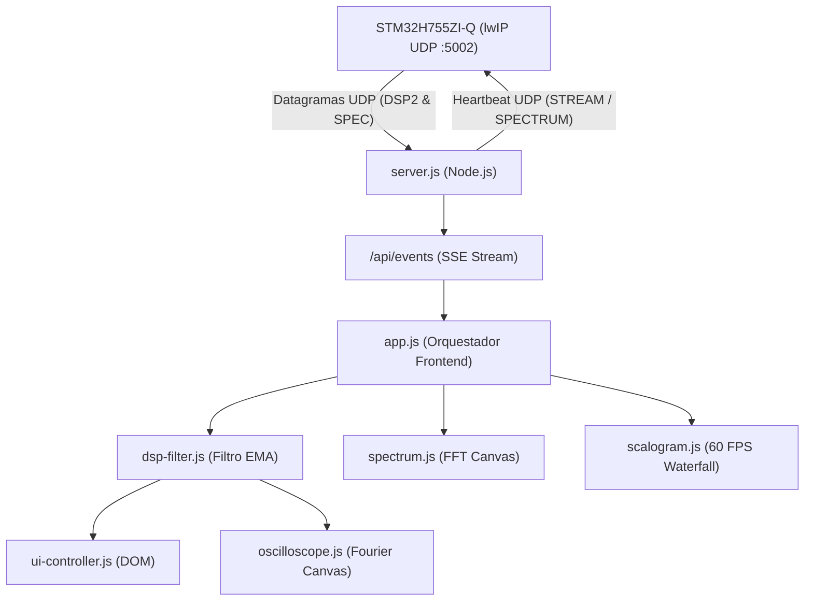

# STM32H755 FFT & DSP Web Monitor Dashboard

Panel de control web en tiempo real para la monitorización de telemetría, espectro de Fourier (FFT), síntesis de onda y descomposición de paquetes Wavelet (WPT) generados por el microcontrolador **STM32H755ZI-Q** (arquitectura Dual-Core Cortex-M7 + Cortex-M4 con IPC D3 y stack Ethernet lwIP UDP).

---

## 1. Características Principales

- **Conexión en Tiempo Real:** Comunicación continua vía **Server-Sent Events (SSE)** hacia el navegador y sockets **UDP** bidireccionales hacia la tarjeta Nucleo.
- **Cero Dependencias Externas:** Desarrollado 100% sobre las API estándar de Node.js (`http`, `dgram`, `fs`, `path`, `os`) y JavaScript moderno nativo (ES Modules). No requiere `npm install` ni librerías de terceros.
- **Diseño Modular y Desacoplado:** Separación estricta entre capa de red/servidor, marcado HTML semántico, estilos CSS y módulos de procesamiento/renderizado frontend.
- **Renderizado Gráfico por Canvas:**
  - **Osciloscopio Sintético:** Reconstrucción continua de la forma de onda $v(t)$ usando Síntesis de Fourier multi-armónica.
  - **Espectro de Magnitud FFT:** Visualización dinámica de 512, 1024 o 2048 bins con detección de pico fundamental.
  - **Escalograma 2D en Cascada (WPT Waterfall):** Visualización espectro-temporal continua a 60 FPS con mapa térmico y suavizado LERP.
- **Análisis Wavelet Multirresolución:**
  - 16 sub-bandas uniformes WPT (Wavelet Packet Transform, base db4) con $\Delta f = 800\text{ Hz}$.
  - Monitor de transitorios rápidos y disturbios con resolución temporal de microsegundos.
  - Cálculo de Entropía de Shannon Wavelet ($S_{\text{WPT}}$) para diagnóstico de complejidad de señal.
- **Filtro Digital Frontend (EMA):** Suavizado configurable mediante Media Móvil Exponencial para estabilizar lecturas en pantalla.

---

## 2. Estructura de Archivos del Proyecto

```text
web_dashboard/
├── README.md                      # Documentación detallada del dashboard
├── server.js                      # Backend Node.js (UDP socket, parser binario, SSE y archivos estáticos)
└── public/
    ├── index.html                 # Estructura semántica HTML5 limpia
    ├── css/
    │   └── style.css              # Estilos CSS3, layout responsive, tema oscuro y animaciones
    └── js/
        ├── app.js                 # Punto de entrada y orquestador frontend (ES Module)
        ├── sse-client.js          # Cliente SSE con reconexión y deserialización de eventos
        ├── dsp-filter.js          # Filtro digital EMA para estabilización de métricas
        ├── oscilloscope.js        # Motor de renderizado del osciloscopio en Canvas
        ├── spectrum.js            # Motor de renderizado del espectro de magnitud FFT
        ├── scalogram.js           # Motor del escalograma 2D en cascada y loop de animación a 60 FPS
        └── ui-controller.js       # Controlador del DOM (métricas, armónicos, wavelets y alertas)
```

---

## 3. Descripción Detallada de los Módulos

### 3.1. Backend: `server.js`

El servidor actúa como puente (*bridge*) de alto rendimiento entre la tarjeta de hardware y los navegadores cliente:

1. **Receptor UDP (Socket `udp4`):**
   - Escucha datagramas entrantes desde la tarjeta STM32H755.
   - **Parser de Telemetría (`0x44535032` - `"DSP2"`):** Desempaqueta campos binarios Little-Endian (frecuencia fundamental $f_0$, magnitud pico, piso de ruido, SNR, THD, offset DC, $V_{pp}$, armónicos $H_1..H_{10}$ y métricas Wavelet WPT/DWT).
   - **Parser de Espectro (`0x53504543` - `"SPEC"`):** Ensambla bloques multi-paquete (hasta 2048 bins) recibidos en fragmentos de 512 bins y los emite en cuanto el bloque se completa.
2. **Comandos de Control UDP:**
   - Envía `'STREAM'` y `'SPECTRUM'` a la tarjeta Nucleo como *heartbeat* mientras haya clientes conectados.
   - Envía `'STOP'` automáticamente cuando todos los navegadores se desconectan para ahorrar ancho de banda y CPU en el microcontrolador.
3. **Transmisor Server-Sent Events (SSE):**
   - Canal unidireccional HTTP persistente en `/api/events` para empujar eventos `telemetry` y `spectrum` sin la sobrecarga de consultas periódicas (*polling*).
4. **Endpoints REST:**
   - `GET /api/telemetry`: Devuelve la última telemetría en formato JSON.
   - `GET /api/spectrum`: Devuelve el último espectro FFT en formato JSON.
   - `GET /api/status`: Diagnóstico de IP de la tarjeta, puerto y clientes activos.
5. **Servidor de Archivos Estáticos:**
   - Resuelve de manera segura las rutas hacia la carpeta `public/` (con protección contra *path traversal*).
   - Sirve activos con sus tipos MIME correspondientes (`.html`, `.css`, `.js`, etc.).

---

### 3.2. Frontend: Vista y Estilos (`public/index.html` y `public/css/style.css`)

- **`index.html`:**
  - Contiene únicamente el marcado semántico sin lógica JavaScript ni reglas de estilo incrustadas.
  - Diseñado con secciones claras: barra de navegación/estado, barra de control (tasa de refresco, filtro EMA, pausa HOLD), tarjetas de métricas cuantitativas, panel de armónicos, osciloscopio, panel de paquetes Wavelet, escalograma 2D y espectro FFT.
- **`css/style.css`:**
  - Esquema visual oscuro de alta legibilidad inspirado en instrumentación de laboratorio digital (`#0b0f19`, `#131b2e`, acentos cian, esmeralda, ámbar y rosa).
  - Rejilla responsiva con CSS Grid que se adapta fluidamente a pantallas de escritorio, tablets y teléfonos móviles.
  - Animaciones CSS optimizadas por GPU (`pulse` para latido de conexión, `alert-pulse` para advertencias de transitorios).

---

### 3.3. Frontend: Capa JavaScript Modular (`public/js/`)

Todos los archivos frontend utilizan **módulos estándar de JavaScript (ES6)**:

#### `app.js` (Orquestador Principal)
- Inicializa e interconecta todas las instancias (`DSPFilter`, `OscilloscopeRenderer`, `SpectrumRenderer`, `ScalogramRenderer`, `UIController`, `SSEClient`).
- Escucha los controles de la interfaz:
  - Botones de tasa de refresco (`2.0s`, `1.0s`, `0.5s`, `0.2s`, `25Hz`).
  - Toggle de filtro de suavizado EMA.
  - Botón de pausa/congelamiento (`HOLD`).
  - Selector de visualización Wavelet (% de energía vs. densidad espectral $\text{mV}^2/\text{Hz}$).
- Coordina el redimensionamiento adaptativo (`resize`) de todos los lienzos Canvas ante cambios de ventana o rotación de pantalla.

#### `dsp-filter.js` (`DSPFilter`)
- Aplica un filtro de Media Móvil Exponencial:
  $$y_k = y_{k-1} + \alpha \cdot (x_k - y_{k-1})$$
  con $\alpha = 0.35$, permitiendo una respuesta ágil a transiciones abruptas manteniendo los dígitos y barras estables ante variaciones de ruido.

#### `oscilloscope.js` (`OscilloscopeRenderer`)
- Dibuja la rejilla calibrada en voltios ($0\text{ a }3.3\text{ V}$) y divisiones de período temporal ($0.5T$, $1.0T$, $2.0T$).
- Reconstruye 2 ciclos de la señal a partir de los armónicos mediante síntesis aditiva:
  $$v(t) = V_{\text{dc}} + \sum_{n=1}^{10} H_n \cdot \sin(2\pi \cdot n \cdot f_0 \cdot t)$$
- Maneja la compensación de densidad de píxeles (`window.devicePixelRatio`) para máxima nitidez en pantallas Retina y OLED móviles.

#### `spectrum.js` (`SpectrumRenderer`)
- Grafica el espectro de magnitud en el dominio de la frecuencia ($0\text{ a }12.8\text{ kHz}$).
- Realiza escalado dinámico de amplitud con gradiente degradado.
- Resalta con un marcador circular la posición del bin fundamental correspondiente a $f_0$.

#### `scalogram.js` (`ScalogramRenderer`)
- Mantiene un buffer histórico de 240 columnas de tiempo.
- Ejecuta un bucle continuo a **60 FPS** utilizando `requestAnimationFrame`.
- Aplica interpolación LERP entre paquetes de red UDP entrantes para lograr transiciones térmicas fluidas.
- Asigna un mapa de color pseudotérmico (plasma: azul $\rightarrow$ cian $\rightarrow$ verde $\rightarrow$ amarillo $\rightarrow$ magenta $\rightarrow$ blanco).
- Incluye monitor de FPS en tiempo real integrado.

#### `ui-controller.js` (`UIController`)
- Encapsula todas las referencias y mutaciones del DOM.
- Formatea y actualiza:
  - Estado del banner (Señal periódica vs. Ruido).
  - Métricas de frecuencia $f_0$, amplitud, THD, calidad armónica y SNR.
  - Offset DC y voltaje pico a pico ($V_{pp}$).
  - Barras de amplitud para los armónicos $H_1$ hasta $H_{10}$.
  - Distribución de energía en las 16 sub-bandas Wavelet WPT ($B_0..B_{15}$).
  - Detección de anomalías y cálculo de tiempo/muestra del transitorio.
  - Medidor de Entropía de Shannon Wavelet normalizada ($S_{\text{norm}}$).

#### `sse-client.js` (`SSEClient`)
- Gestiona la conexión con `EventSource('/api/events')`.
- Maneja eventos de ciclo de vida (`onopen`, `onerror` para reconexión automática) y canaliza los eventos `telemetry` y `spectrum`.

---

## 4. Instrucciones de Uso

### 4.1. Requisitos Previos
- **Node.js** v18 o superior instalado en el equipo host (no se requiere instalar nada mediante npm).

### 4.2. Iniciar el Servidor
Puedes iniciar el dashboard de dos maneras:

1. **Mediante el script por lotes (recomendado en Windows):**
   Doble clic en:
   ```text
   Tools/start_web_dashboard.bat
   ```
2. **O desde la terminal:**
   ```bash
   cd Tools/web_dashboard
   node server.js
   ```

### 4.3. Variables de Entorno Opcionales
Si necesitas ajustar puertos o la IP de la tarjeta:
```bash
set PORT=8088
set BOARD_IP=192.168.1.172
set BOARD_PORT=5002
node server.js
```

### 4.4. Acceder al Monitor
- **Desde la misma PC:** Abre tu navegador en [http://localhost:8088](http://localhost:8088).
- **Desde un celular o tablet:** Conecta el dispositivo a la misma red Wi-Fi y abre la dirección IP local mostrada en la consola al iniciar el servidor (por ejemplo, `http://192.168.1.100:8088`).

---

## 5. Resumen de Flujo de Datos


